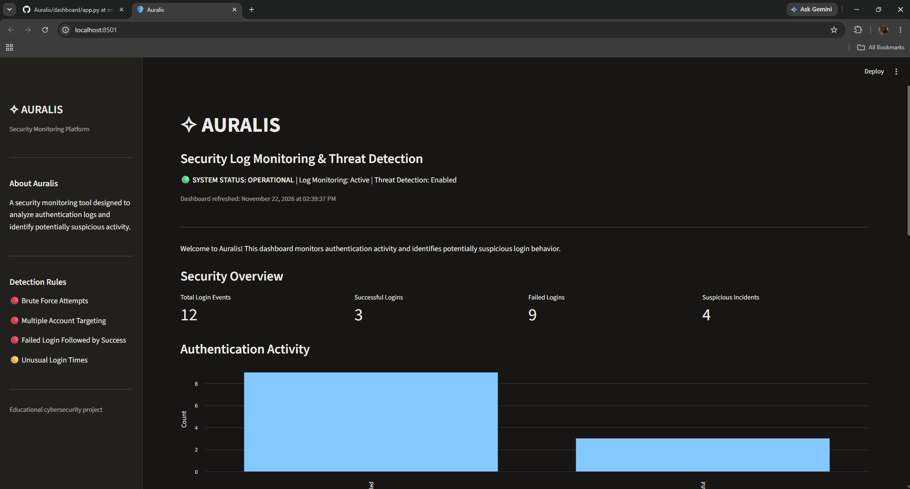

# Auralis
### Cybersecurity Log Monitoring & Threat Detection Platform

Auralis is a Python-based cybersecurity project designed to analyze authentication logs, identify potentially suspicious login activity, and generate structured security incident reports.

The project demonstrates foundational cybersecurity concepts, including log analysis, threat detection, incident reporting, and MITRE ATT&CK mapping.

## Project Goals

- Analyze Linux authentication logs.
- Detect repeated failed login attempts.
- Identify suspicious activity targeting multiple accounts.
- Flag successful logins following failed attempts.
- Identify logins occurring outside expected hours.
- Generate structured JSON incident reports.
- Map relevant detections to MITRE ATT&CK.

## Technologies Used

- Python
- Streamlit
- Regular Expressions (Regex)
- JSON
- Pytest
- MITRE ATT&CK Framework

## Detection Capabilities

Auralis currently implements four detection methods:

| Detection | Description | Severity |
|---|---|---|
| Brute Force Attempt | Identifies repeated failed login attempts against an account from the same IP address. | High |
| Multiple Account Targeting | Detects an IP address attempting to access multiple usernames. | High |
| Failed Login Followed by Success | Flags a successful login after previous failed attempts from the same IP address and username. | High |
| Unusual Login Time | Identifies successful logins outside the configured hours of 6 AM–10 PM. | Medium |

## Incident Reporting

When suspicious activity is detected, Auralis generates structured JSON incident reports containing:

- Unique incident ID
- Date and time generated
- Incident type and severity
- Source IP address
- Associated username
- Supporting evidence
- Recommended response
- MITRE ATT&CK mapping, when applicable

## Dashboard

The Streamlit dashboard provides an overview of authentication activity, including login statistics, suspicious incidents, severity breakdowns, and incident details.

## Installation

1. Clone the repository:

   ```bash
   git clone https://github.com/YOUR-USERNAME/Auralis.git
   ```

2. Navigate into the project directory:

   ```bash
   cd Auralis
   ```

3. Install the required dependencies:

   ```bash
   python -m pip install streamlit pytest
   ```

## Running the Dashboard

Start the Auralis dashboard with:

```bash
python -m streamlit run dashboard/app.py
```

Streamlit will open the dashboard in your web browser.

## Running Tests

Run the automated test suite with:

```bash
python -m pytest -v
```

## Project Status

Auralis is an actively developed educational cybersecurity project. Its current detection rules use synthetic authentication log data and are intended for learning and demonstration purposes.

## Project Structure

```text
SentinelWatch/
├── data/
│   └── sample_auth.log
├── src/
│   ├── log_parser.py
│   ├── threat_detector.py
│   ├── report_generator.py
│   └── mitre_mapping.py
├── tests/
│   ├── test_threat_detector.py
│   ├── test_report_generator.py
│   └── test_mitre_mapping.py
├── dashboard/
│   └── app.py
├── reports/
└── README.md
```

## Learning Objectives

This project was developed to strengthen practical skills in:

- Python programming
- Cybersecurity log analysis
- Identifying suspicious authentication patterns
- Automated testing with Pytest
- Security incident documentation
- MITRE ATT&CK framework research
- Building interactive dashboards with Streamlit

## Dashboard Preview

The Auralis dashboard provides a visual overview of authentication activity, detected threats, and security incidents.

